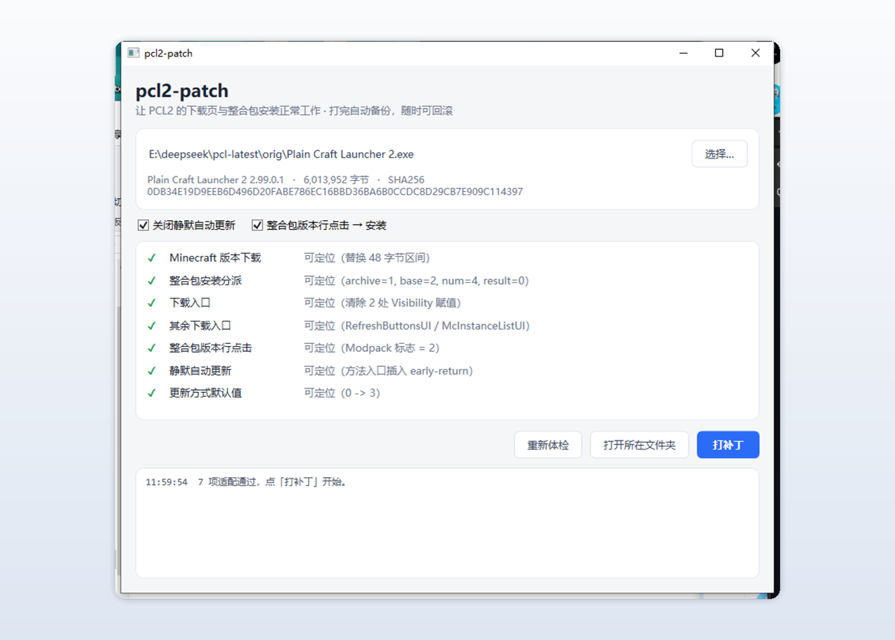

<div align="center">


# pcl2-patch

**让 Plain Craft Launcher 2 的下载页与整合包安装重新工作**

<sub>图形化 · 按版本适配 · 自动备份 · 随时可回滚</sub>

<br/>

<a href="https://github.com/ShiraiFyuya/pcl2-patch/releases/latest">
  
</a>
<a href="https://shiraifyuya.github.io/pcl2-patch/">
  
</a><a href="https://github.com/ShiraiFyuya/pcl2-patch/releases">
  
</a>
<a href="LICENSE">
  
</a>

<br/>

<a href="https://github.com/Meloong-Git/PCL">
  
</a>


<br/><br/>



</div>

---

## 效果

<div align="center">
  
</div>

## 支持版本

| PCL 版本 | 状态 | 补丁项 | 说明 |
| :--- | :---: | :---: | :--- |
| `2.99.0.1` | ✅ 已适配 | **7** | 含「原版游戏」入口与启动页下载按钮的还原 |
| `2.99.0.0` | ✅ 已适配 | **5** | 另 2 项该版本没有对应改动，自动跳过 |
| `PCL-CE 2.15.1` | ✅ 已适配 | 1 | 社区版（C# 重写，.NET 单文件包），解除地区限制判定 |
| 其它版本 | ⚠️ 未适配 | — | 拖进工具会逐项显示能否定位，未适配项标红并写明原因 |

版本号取自 exe 的「文件版本」（右键 → 属性 → 详细信息），工具顶部也会显示读取到的版本。

## 快速开始

**第一步 · 选一个下载**（两个功能、效果、产物完全一致，只是运行环境不同）

| 文件 | 大小 | 什么时候用 |
| :--- | :---: | :--- |
| **`pcl2-patch-gui.exe`** | **约 300 KB** | **推荐**。跑在 Windows 自带的 .NET Framework 4.8 上（Win10 1809+ / Win11 预装），启动快、体积小 |
| `pcl2-patch-gui-net9.exe` | 约 58 MB | 系统被精简、4.8 缺失或损坏时用。自带 .NET 9 运行时，不依赖系统组件 |

**第二步 · 按向导走四步**

| 步骤 | 内容 |
| :---: | :--- |
| ① 选择文件 | 把启动器 exe 拖进虚线框，或点「浏览选择…」 |
| ② 体检结果 | 顶部明确显示识别到的启动器与版本（如 `PCL2 原版 · 2.99.0.1`），右侧给出结论（`已适配 · 7 项可写入`），下面逐项列出定位结果 |
| ③ 确认并执行 | 核对目标路径与将写入的项，点「开始打补丁」，自动完成 **备份 → 写入 → 自检** |
| ④ 完成 | 显示备份路径，可打开文件夹或继续处理下一个文件 |

**回滚**：同目录下会生成 `Plain Craft Launcher 2.exe.bak`，覆盖回去即可。

> ⚠️ 打完**不要点 PCL 的「检查更新」**，会覆盖成官方版；更新后重跑一次本工具即可。

## 常见问题

<details>
<summary><b>会不会改坏文件？</b></summary>

不会。工具先复制副本再操作，写入前后各探测一次，全部通过才落盘；中途失败不会动原文件。
</details>

<details>
<summary><b>要不要装 .NET？</b></summary>

默认的 `pcl2-patch-gui.exe` 不用，它跑在 Windows 自带的 .NET Framework 4.8 上（Win10 1809+ / Win11 预装）。

万一系统缺 4.8（精简版系统常见），换 `pcl2-patch-gui-net9.exe`，那个自带运行时。
</details>

<details>
<summary><b>怎么安装本地的整合包？</b></summary>

把整合包压缩包（zip / mrpack / rar）直接拖到 PCL 窗口上即可开始安装；也可以在启动器目录放一个 `modpack.zip`，启动时会自动识别。
</details>
<details>
<summary><b>PCL 更新了怎么办？</b></summary>

启动器更新会覆盖文件，补丁随之失效。重跑一次本工具即可；如果新版本还没适配，界面会把不可用的项标红说明原因，不会写坏。
</details>

<details>
<summary><b>和别的「解除限制」工具有什么不同？</b></summary>

- **按版本适配**：补丁项按 PCL 版本挂载，新版本新增的隐藏逻辑会被单独处理，而不是一套补丁硬套所有版本；
- **不注入任何东西**：只还原 PCL 原本的行为，不往目标程序里加弹窗、注册表项或后台逻辑；
- **写入有自检**：定位失败、指纹不符时一律中止，绝不强写。

</details>

## 技术实现

引擎基于 [Mono.Cecil](https://github.com/jbevain/cecil)：读入程序集、在内存里改 IL、写回新文件。**仓库不含 PCL 的任何原始字节** —— 定位完全依赖类型名、方法签名、IL 结构与数据流，例如「`PageLoaderInit` 调用前最后一个 `newobj LoaderTask<,>`」「`OpenZip` 的返回值落进了哪个局部变量」。

原理、补丁清单与「PCL 出新版本后怎么做适配」见 [docs/TECHNICAL.md](docs/TECHNICAL.md)。

## 从源码构建

```bat
git clone https://github.com/ShiraiFyuya/pcl2-patch.git
cd pcl2-patch
dotnet build pcl2-patch.sln -c Release
```

推 `v*` tag 会触发自动构建，同时产出 `.NET Framework 4.8` 与 `.NET 9` 两个版本并挂到 Release。

---

<div align="center">
<sub>

本项目采用 [GPL-3.0](LICENSE) 许可 · Copyright © 2026 ShiraiFyuya

仅用于自己拥有的副本 · 与 PCL 官方无关 · 使用前请自行评估风险

</sub>
</div>
