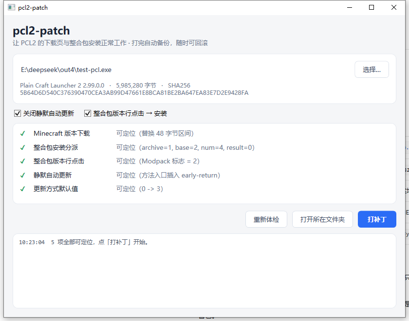
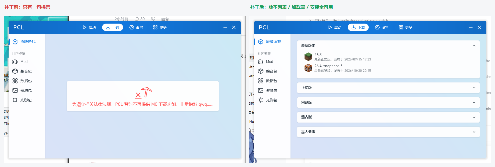

# pcl2-patch


为 [Plain Craft Launcher 2](https://github.com/Meloong-Git/PCL)（PCL2）提供一份下载页与整合包安装的修复补丁。

[**⬇ 下载最新版**](https://github.com/ShiraiFyuya/pcl2-patch/releases/latest) · [实现说明](docs/TECHNICAL.md)



## 效果

<p align="center">
  
</p>

## 能做什么

- **下载 Minecraft** —— 「下载 → 原版游戏」可以正常列出版本，Forge / NeoForge / Fabric / OptiFine / LiteLoader 全流程可用
- **安装整合包** —— 资源页点版本直接开始安装，不用「另存为后自己解压」
- **更新提示** —— 默认只在你手动检查时提示，不会在后台自行替换启动器文件

## 使用

1. 下载 `pcl2-patch-gui.exe`（单文件，免安装）；
2. 把 `Plain Craft Launcher 2.exe` 拖进窗口，或点「选择…」；
3. 五项检查都是 ✓ 后，点「打补丁」；
4. 确认即可，过程全自动：**备份 → 写入 → 自检**。

界面上的两个开关：

| 开关 | 作用 |
| --- | --- |
| 关闭静默自动更新 | 不在后台自动替换启动器，改为手动检查时提示 |
| 整合包版本行点击 → 安装 | 点版本直接安装，而不是先另存为 |

## 常见问题

**打完补丁，PCL 又更新了怎么办？**
再打一次就行。启动器更新会覆盖文件，重新打开本工具点一下即可。

**怎么还原？**
同一目录下会自动生成 `Plain Craft Launcher 2.exe.bak`，用它覆盖回去即可。

**支持哪些版本？**
目前针对 PCL2 `2.99.0.0`。其他版本也可以直接拖进去试试，界面会告诉你哪几项可用、哪几项需要更新。

**会不会改坏文件？**
不会。工具先复制副本再操作，写入前后各检查一次，中途失败不会动原文件。

## 从源码构建

```bat
git clone https://github.com/ShiraiFyuya/pcl2-patch.git
cd pcl2-patch
dotnet build pcl2-patch.sln -c Release
```

推 `v*` tag 会触发自动构建，产物见 Releases。

## 更多

实现细节、补丁清单、以及「PCL 更新后如何适配」见 [docs/TECHNICAL.md](docs/TECHNICAL.md)。

## 许可

[GPL-3.0](LICENSE) · Copyright (C) 2026 ShiraiFyuya

- 可以自由使用、修改、分发，也可以收费分发；
- 但**分发修改版时必须一并提供源码**，并沿用 GPL-3.0、保留原作者的版权声明；
- 也就是说：**改名打包、闭源拿去卖，是违反本协议的**。

发现有人违反协议转卖，欢迎 [开 issue](../../issues) 告诉我。
